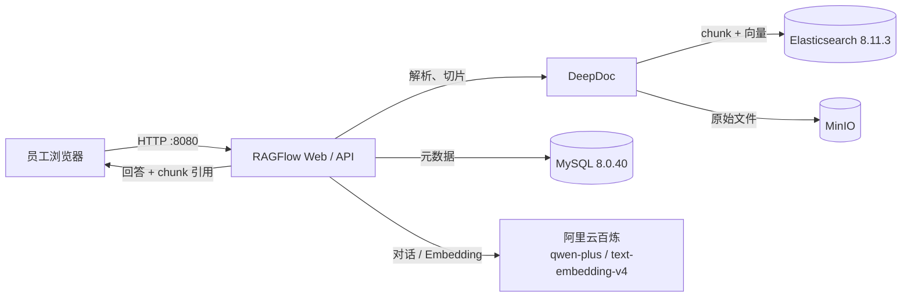

# enterprise-rag-kb

企业内部 RAG 知识库（本地演示验证版）：员工上传 PDF/Word，用自然语言提问，系统检索文档后生成回答，并标明引用来源。

> **第一版范围**：在单台企业内部 Windows 电脑上用 Docker 本地演示验证；不购买云服务器、不部署本地大模型、不做公网暴露。
>
> **当前进度**：第一步（项目初始化与环境准备）已完成。**尚未启动 RAGFlow，也未导入任何资料**，部署与入库属于第二步。

## 1. 目标与验收标准

| 验收项 | 第一版如何满足 |
| --- | --- |
| 上传 PDF/Word | RAGFlow 知识库上传，DeepDoc 解析 PDF/Word |
| 自然语言聊天查询 | RAGFlow 内置聊天助手，基于知识库检索问答 |
| 回答标明引用来源 | RAGFlow 的 chunk 级引用：回答中的引用编号可展开为原始文档片段 |
| 本地演示、无云服务器 | Docker Desktop 在本机运行，全部组件本地容器化 |
| 不部署本地大模型 | 只调用在线模型 API（阿里云百炼） |

## 2. 技术选型（决策记录）

### 2.1 选型结论

| 层次 | 选型 | 版本 | 说明 |
| --- | --- | --- | --- |
| RAG 应用 | **RAGFlow** | **v0.27.2**（当前最新稳定版） | 唯一选用的 RAG 基础应用，**不安装 Dify** |
| 文档解析 | RAGFlow 内置 DeepDoc | 随镜像 | 版面分析、表格识别、OCR，覆盖 PDF/Word |
| 向量数据库 | **Elasticsearch** | 8.11.3 | 使用 RAGFlow 官方 compose 自带组件，不单独搭建 |
| 元数据库 | MySQL | 8.0.40 | compose 自带 |
| 对象存储 | MinIO 兼容服务（`pgsty/silo`） | 随 compose 固定 | compose 自带，保存原始文件 |
| 缓存 | Valkey | 8 | compose 自带，替代 Redis |
| 对话大模型 | 阿里云百炼 `qwen-plus` | 在线 API | 通过 OpenAI 兼容接口接入 |
| Embedding | 阿里云百炼 `text-embedding-v4` | 在线 API | 与对话模型共用一把 API key |
| 容器运行时 | Docker Desktop + Docker Compose | 见第 4 节 | Windows 本机运行 |

### 2.2 为什么选 RAGFlow，而不是 Dify

1. **chunk 级引用能力直接满足验收要求。** RAGFlow 的回答会附带可展开的引用列表，引用能定位到具体文档的 chunk（片段），而不是只给一个文件名。验收要求“标明原始文件依据”，这一点是决定性因素。官方特性说明见 [RAGFlow README · Grounded citations](https://github.com/infiniflow/ragflow/blob/v0.27.2/README.md#-grounded-citations-with-reduced-hallucinations)。
2. **复杂文档解析更贴合企业资料。** 产品说明书、检验规范、设备手册通常含表格、页眉页脚和扫描页；RAGFlow 的 DeepDoc 提供版面分析、表格识别与 OCR，切片结果可在界面中人工检查、干预。
3. **一体化程度高。** 解析、切片、索引、检索、对话、引用在一个应用内完成，官方 compose 已包含 Elasticsearch、MySQL、MinIO、Valkey，不需要额外拼装。
4. **许可证与部署方式适合企业内部。** Apache-2.0，支持本地 Docker 私有化部署。
5. **不装 Dify 的理由。** Dify 更偏工作流/Agent 编排，知识库只是其中一块；本项目的验收重点是“文档解析质量 + chunk 可追溯引用”，RAGFlow 更直接。同时部署两套系统会显著增加内存、磁盘和运维负担，本机资源（见第 4 节）也不允许，因此明确只选一套。

### 2.3 为什么不单独搭向量数据库

RAGFlow 官方 compose 通过 `DOC_ENGINE` 选择文档引擎，默认使用 Elasticsearch 8.11.3，并同时提供 MySQL、MinIO、Valkey。第一版直接复用这套集成组件：

- 避免重复占用内存和磁盘；
- 避免版本兼容问题（RAGFlow 对 ES 版本和 mapping 有要求）；
- 部署步骤更少，演示更稳定。

后续数据量或并发上升时，再评估切换 Infinity、OpenSearch 或外部 Elasticsearch 集群。

### 2.4 在线模型服务与密钥管理

第一版只接入**一个**在线模型服务：阿里云百炼（DashScope）。

- 对话模型：`qwen-plus`，OpenAI 兼容地址 `https://dashscope.aliyuncs.com/compatible-mode/v1`
- Embedding：`text-embedding-v4`（RAGFlow 的 Tongyi-Qianwen 提供方已内置该模型）
- 一个 `DASHSCOPE_API_KEY` 同时覆盖对话与向量化，减少密钥数量
- 选择理由：国内网络可直连、中文文档与中文语义效果好、按量计费适合演示、RAGFlow 原生支持该提供方

密钥管理规则：

1. API key 只通过环境变量或本机 `.env` 提供，**禁止写入代码、文档、截图或 commit**。
2. 仓库只提交 `.env.example` 占位模板；`.env` 已被 `.gitignore` 忽略。
3. RAGFlow 的模型 key 在 Web 界面中配置并保存在本地 MySQL；配置时不得把真实 key 粘贴进任何仓库文件。
4. 后续如需切换模型（如 DeepSeek、智谱 GLM），只改 RAGFlow 模型配置，不改业务数据。

> 备选：DeepSeek 的 `deepseek-chat` 也兼容 OpenAI 协议，可用于对话；但它不提供 embedding，仍需百炼做向量化。第一版为降低复杂度不启用双供应商。

## 3. 架构与引用链路



一次问答的引用链路：

1. 员工上传 PDF/Word，RAGFlow 保存原始文件并解析为文本块（chunk）。
2. 每个 chunk 生成向量写入 Elasticsearch，同时记录所属文档、页码/位置等元数据。
3. 提问时，问题向量召回相关 chunk，拼装为上下文发送给 `qwen-plus`。
4. 模型回答中携带引用编号；RAGFlow 把编号映射回 chunk，在回答下方展示“引用来源”。
5. 点击引用可查看命中的原始片段，从而核对答案依据。

**验收判定口径**：每条包含事实性结论的回答，至少能展开 1 条引用；引用必须能定位到具体文件与片段，而不是只有文件名。

## 4. 环境检查（Windows / Docker）

> 本节在“环境检查与准备”子任务完成后补充实测数据。

结论：待检查。

## 5. 仓库结构

```text
enterprise-rag-kb/
├── README.md               # 项目说明、选型决策、环境结论
├── known-issues.md         # 已知问题清单
├── .env.example            # 密钥占位模板（不含真实值）
├── docs/
│   ├── deployment.md       # RAGFlow 部署步骤与官方 compose 配置
│   ├── design.md           # 方案设计与取舍
│   ├── tooling.md          # 辅助工具使用记录（skill-atlas）
│   └── ragflow/            # 官方 compose 配置快照（v0.27.2）
├── data/                   # 虚构企业资料源文件与清单
├── tests/                  # 测试问题、期望引用与结果
└── scripts/                # 环境检查脚本
```

## 6. 部署与使用

完整步骤见 [docs/deployment.md](docs/deployment.md)。

**第一步只做环境检查，不执行部署。** 当前仓库不包含运行中的容器、不包含已入库的文档，也不包含任何真实密钥。

第二步计划：

1. 处理 [known-issues.md](known-issues.md) 中的磁盘/内存前置条件；
2. 按 `docs/deployment.md` 启动 RAGFlow；
3. 配置百炼模型与 embedding；
4. 导入 `data/` 下的虚构 PDF/Word；
5. 用 `tests/` 中的问题做检索与引用验收。

## 7. 安全与合规

- **数据全部虚构**：公司名、产品型号、检验数值均为演示用虚构内容；禁止提交真实公司资料、客户信息、工艺配方等敏感数据。
- **密钥不入库**：API key、数据库密码只存在于本机环境变量或未跟踪的 `.env` 中；提交前用 `git diff --cached` 自查。
- **不暴露公网**：RAGFlow 仅监听本机/内网，演示阶段不做端口映射到公网，不启用公网域名。
- **最小权限**：Docker Desktop 与 RAGFlow 使用本机个人环境，不接入企业域账号；后续再做账号与权限设计。

## 8. 第一版范围与非目标

**范围内**

- 3 类虚构企业资料（产品说明书、质量检验规范、设备操作手册）入库
- 10 条左右测试问题，覆盖单文档事实、跨段落、数值指标、无答案拒答
- 回答带 chunk 级引用，可人工核对
- 单机 Docker 本地演示

**非目标（第一版不做）**

- 本地大模型 / GPU 推理
- 云服务器、公网访问、SSO、多租户
- 高可用、备份恢复、审计日志
- 自动同步企业网盘 / OA
- 移动端适配

## 9. 里程碑

| 阶段 | 内容 | 状态 |
| --- | --- | --- |
| 第一步 | 仓库初始化、选型、环境检查、部署文档、资料骨架 | ✅ 本次完成 |
| 第二步 | 处理资源问题、启动 RAGFlow、制作并导入虚构资料 | 待开始 |
| 第三步 | 测试问题集、引用核验、演示与已知问题收敛 | 待开始 |

## 10. 版本管理规范

- 每完成一个子任务提交一次 commit，消息使用 Conventional Commits 前缀（`chore:`、`docs:`、`feat:`、`fix:`）。
- commit 正文说明“改了什么、为什么”。
- 严禁提交 API key、密码、真实企业资料；`.gitignore` 已拦截常见密钥文件。
- 重要决策写入 README 或 `docs/design.md`，保证历史可追溯。

## 11. 辅助工具链

按任务要求评估并使用了 [skill-atlas](https://github.com/haozhouliuliuliu/skill-atlas)（GitHub 能力位索引工具）辅助检索可复用组件与规范。它本身不是 RAG 组件，也不参与运行时；使用记录与结论见 [docs/tooling.md](docs/tooling.md)。
