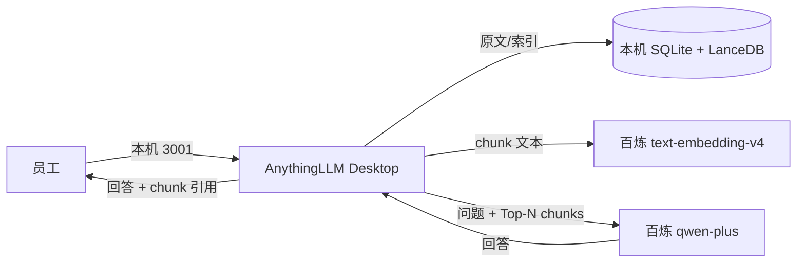

# enterprise-rag-kb

企业内部 RAG 知识库（本地演示验证版）：员工上传 PDF/Word，用自然语言提问，系统检索文档后生成回答，并标明引用来源。

> **第一版范围**：在单台企业内部 Windows 电脑上本地演示；不购买云服务器、不部署本地大模型、不做公网暴露。
>
> **当前底座**：AnythingLLM Desktop v1.18.0（原生 Windows 应用，不依赖 Docker/WSL2）。
>
> **当前进度**：RAGFlow 方案已废弃；AnythingLLM 已安装并启动，百炼模型、workspace、Developer API、重启持久化与 SMOKE-01 评测通道均已验证。正式资料入库与 14+ 题评测属于第三步。
>
> **换机 / 新会话交接**：先读 [HANDOFF.md](HANDOFF.md) 顶部的底座变更说明，再按 [docs/deployment.md](docs/deployment.md) 操作。HANDOFF 中的 RAGFlow 步骤仅作历史记录。

## 1. 目标与验收标准

| 验收项 | 第一版如何满足 |
| --- | --- |
| 上传 PDF/Word | AnythingLLM workspace 上传，内置解析器提取文本 |
| 自然语言聊天查询 | workspace 聊天，检索本地向量库后调用 `qwen-plus` |
| 回答标明引用来源 | 回答下方展示 sources/chunk 片段，可展开核对 |
| 本地演示、无云服务器 | AnythingLLM Desktop 运行在本机；仅模型调用走外部 API |
| 不部署本地大模型 | 对话与 Embedding 均使用阿里云百炼在线 API |

**v0.2 验收基准（后续所有测试以此为准）：**

| 指标 | 目标 |
| --- | --- |
| 检索命中 | 可回答问题中 **≥ 80%** 能在检索结果前 5 条中找到相关依据 |
| 回答有据 | 可回答问题中 **≥ 80%** 的最终回答提供真实、足以支持回答的来源 |
| 正确拒答 | **5 道无答案问题中 ≥ 4 道**明确表示资料不足，不编造 |
| 可复现 | 每题都有预期结果或明确判定规则，不能只记录 AI 输出 |

## 2. ADR-001：底座从 RAGFlow 切换为 AnythingLLM

- **状态**：Accepted（2026-10-18）
- **决策**：废弃 RAGFlow + Docker Desktop 方案，改用 **AnythingLLM Desktop v1.18.0** 作为唯一 RAG 应用。
- **取代**：v0.1 的 RAGFlow 选型；`docs/ragflow/` 与 `docs/deployment.md` 的旧版本仅作历史参考。

### 2.1 背景

v0.1 方案选择 RAGFlow v0.27.2，依赖 Docker Desktop + WSL2，并由官方 compose 拉起 Elasticsearch 8.11.3、MySQL 8.0.40、MinIO/SILO、Valkey 8。目标机实测环境为：

- Windows 10 Pro 22H2，Build 19045.5854；
- Intel Core i7-3770，4 核 8 线程；
- 物理内存 15.96 GB；
- C 盘可用 79.31 GB，D 盘可用 320.75 GB；
- **Docker Desktop、Docker CLI、Compose、WSL2 均未安装/未启用**；
- 旧机 Docker VM 仅 7.43 GB，低于 RAGFlow 演示建议的 12 GB。

即使磁盘空间已达标，RAGFlow 仍需先启用 WSL2、安装 Docker Desktop、迁移/调优 Docker VM 内存，再拉起多个基础组件容器。对一台 2012 年平台、16 GB 内存的演示机，这套底座的安装复杂度、内存压力和故障面都偏高，且第二步尚未开始就已出现 Docker/WSL 阻塞。

### 2.2 决策理由

1. **原生 Windows 应用，去掉 Docker/WSL2 依赖。** AnythingLLM Desktop 直接安装运行，不需要 Docker Desktop、WSL2、Hyper-V 或 Linux 虚拟机，直接规避 KI-002（Docker VM 内存）与 KI-010（Docker/WSL 缺失）。
2. **资源占用更符合目标机。** 不再需要为 Elasticsearch/MySQL/MinIO/Valkey 预留 12 GB 级 VM 内存；16 GB 物理内存可以留给 Windows、浏览器和应用本身。
3. **仍然满足核心验收。** AnythingLLM 支持 workspace、PDF/Word 上传、本地向量检索、回答下方 sources/chunk 引用，能验证“检索—回答—引用”闭环。
4. **自带 Developer API，便于可复现评测。** 可在设置中启用 API，用脚本逐题调用并记录回答、来源与判定，不必手工截图。
5. **单一应用、单机演示。** 不引入 Dify、不引入第二套 RAG 应用，符合“只装一套”的约束。

### 2.3 代价与风险

| 代价/风险 | 说明 | 应对 |
| --- | --- | --- |
| 数据出本机 | chunk 文本与问题会发送至阿里云百炼 | 只用虚构资料；在架构与安全文档中明示 |
| 解析/切片可控性较弱 | 不如 RAGFlow 的 DeepDoc 可调参数多 | 第一版先跑通；解析质量不足时再评估专用解析器 |
| 引用粒度依赖应用 | sources 为 chunk 级，但展示形式受 AnythingLLM 限制 | 用 `sources[].chunk` 与人工核对双重验证 |
| 桌面版单用户 | 无 SSO、多租户、细粒度权限 | 第一版定位为单机演示，不扩展到生产 |
| 外部模型依赖 | 百炼欠费/限流会导致问答失败 | 演示前检查额度；记录为已知依赖 |

### 2.4 复审条件

出现以下情况时重新评估底座：

- AnythingLLM 无法满足 chunk 级引用验收；
- 需要多用户、权限隔离、审计或高可用；
- 企业要求数据完全不出内网；
- 文档解析质量成为主要瓶颈，且应用内无法调优。

## 3. 技术选型

| 层次 | 选型 | 版本/说明 |
| --- | --- | --- |
| RAG 应用 | **AnythingLLM Desktop** | **v1.18.0**，原生 Windows 应用，不装 Dify |
| 文档解析 | AnythingLLM 内置解析器 | PDF/Word 文本提取、切片 |
| 向量库 | LanceDB | AnythingLLM 内置，本地文件 |
| 元数据 | SQLite | AnythingLLM 内置 |
| 对话模型 | 阿里云百炼 `qwen-plus` | OpenAI 兼容接口 |
| Embedding | 阿里云百炼 `text-embedding-v4` | 与对话共用 `DASHSCOPE_API_KEY` |
| 接口地址 | `https://dashscope.aliyuncs.com/compatible-mode/v1` | 百炼 OpenAI 兼容模式 |
| 容器 | **无** | 不使用 Docker/WSL2 |
| 评测通道 | AnythingLLM Developer API + Python | `tests/eval.py`，仅标准库 |

**不选 Dify 的理由**：本项目只需要单机文档问答与引用，不需要工作流/Agent 编排；再部署一套应用会增加资源和运维负担。

**不再选 RAGFlow 的理由**：见 ADR-001。

## 4. 架构与引用链路

完整架构、数据流与外部服务边界见 [docs/architecture.md](docs/architecture.md)。



**引用链路：**

1. 上传 PDF/Word，在本机解析、切片；
2. chunk 文本发送到百炼生成向量，向量写入本机 LanceDB；
3. 提问时问题向量化，本机检索 Top-N chunk；
4. 问题与 chunk 发送给 `qwen-plus`，返回回答；
5. AnythingLLM 把回答与 chunk 元数据关联，展示 sources；
6. 验收时检查引用片段是否真的支持回答。

> **数据边界**：文档切片和问答内容会发送至百炼（阿里云）外部服务；原始文件留在本机，但文本内容会离开本机。只允许虚构资料。

## 5. 环境检查（新机实测）

检查时间：2026-10-18。旧机 RAGFlow/Docker 数据保留在 [known-issues.md](known-issues.md) 作为历史。

| 项目 | 实测值 | 说明 |
| --- | --- | --- |
| 操作系统 | Windows 10 Pro 22H2，Build 19045.5854，64 位 | 原生应用可运行；系统已过常规支持期，见 KI-011 |
| CPU | Intel Core i7-3770，4 核 8 线程，3.40 GHz | 满足桌面应用与在线模型调用 |
| 物理内存 | 15.96 GB | 不再需要 12 GB Docker VM，资源压力显著降低 |
| C 盘可用 | 79.31 GB / 150 GB | 满足安装与数据目录 |
| D 盘可用 | 320.75 GB / 326.93 GB | AnythingLLM 安装在此 |
| AnythingLLM | v1.18.0，安装于 `D:\RAG库\AnythingLLM` | 安装包签名有效（Mintplex Labs） |
| 本机服务 | `127.0.0.1:3001`（应用/API）、`127.0.0.1:8888`（collector） | 仅本机监听 |
| 数据目录 | `%APPDATA%\anythingllm-desktop` | 本机为 `C:\Users\Administrator\AppData\Roaming\anythingllm-desktop` |
| 百炼模型 | `qwen-plus` + `text-embedding-v4` 已保存 | chat/embedding 直连验证通过；embedding 1024 维 |
| workspace | `enterprise-rag-kb`（id=2） | 重启后仍存在，P1-07 通过 |
| Developer API | 已启用，SMOKE-01 命中 | key 只在本机 `.env`/仓库外文件 |
| Docker/WSL2 | 未安装/未启用 | **已不需要**；KI-002、KI-010 通过更换底座规避 |
| 8080 端口 | 空闲 | 本方案不使用 8080；AnythingLLM 使用 3001 |

**资源结论**：RAGFlow 时代的 C 盘、Docker VM 内存、WSL2 阻塞均已不再适用；当前主机满足 AnythingLLM 桌面版演示条件。

## 6. 仓库结构

```text
enterprise-rag-kb/
├── README.md                    # 目标、ADR-001、选型、环境结论
├── HANDOFF.md                   # 交接说明（顶部有底座变更提示）
├── known-issues.md              # 已知问题与历史状态
├── docs/
│   ├── deployment.md            # AnythingLLM 安装、模型配置、验证
│   ├── architecture.md          # 架构、数据流、外部服务边界
│   ├── security.md              # 密钥、虚构数据、外部数据流
│   ├── design.md                # 设计说明（v0.2 入口）
│   ├── tooling.md               # 辅助工具记录（历史）
│   └── ragflow/                 # v0.1 RAGFlow 配置快照（历史，不再使用）
├── data/                        # 虚构资料源文件与清单
├── tests/
│   ├── questions.v0.1.md        # 旧版 Markdown 问题集
│   ├── questions.v0.2.json      # 评测脚本使用的 JSON 题集（当前含占位题）
│   ├── eval.py                  # Developer API 评测脚本
│   └── results/                 # 评测结果
└── scripts/
    └── check-env.ps1            # 旧版 Windows/Docker 检查脚本（历史）
```

## 7. 部署与使用

完整步骤见 [docs/deployment.md](docs/deployment.md)。

快速路径：

1. 启动 `D:\RAG库\AnythingLLM\AnythingLLM.exe`；
2. 在设置中配置百炼 `qwen-plus` 与 `text-embedding-v4`；
3. 创建 workspace `enterprise-rag-kb`；
4. 上传 `data/` 下的虚构 PDF/Word；
5. 启用 Developer API，把 key 写入本机 `.env`；
6. 运行 `python tests/eval.py` 做评测。

> `.env` 只在本机，已被 `.gitignore` 忽略；仓库只保留 `.env.example`。

## 8. 安全与合规

完整基线见 [docs/security.md](docs/security.md)。

- **资料全部虚构**：禁止真实公司资料、客户信息、工艺参数、个人信息。
- **密钥不入库**：模型 key 在 AnythingLLM 界面录入；Developer API key 只放环境变量或本机 `.env`。
- **不暴露公网**：AnythingLLM 仅监听 `127.0.0.1`，不做端口映射。
- **明确外部数据流**：文档 chunk 与问题会发送到阿里云百炼；只用于虚构演示。
- **遥测**：已在 Settings → Privacy 关闭匿名遥测（`DISABLE_TELEMETRY='true'`）。

## 9. 第一版范围与非目标

**范围内**：3 类虚构资料（产品说明书、质量检验规范、设备操作手册）、可复现问题集、chunk 引用、单机演示。

**非目标**：本地大模型/GPU、云服务器、公网访问、SSO、多租户、高可用、自动同步企业网盘、移动端适配、生产级权限与审计。

## 10. 里程碑

| 阶段 | 内容 | 状态 |
| --- | --- | --- |
| 第一步 | RAGFlow 方案初始化、文档、环境检查 | ✅ 已完成，底座已废弃 |
| 第二步 | AnythingLLM 部署、workspace、Developer API、评测通道 | ✅ 本次完成（SMOKE-01 命中，P1-07 通过） |
| 第三步 | 资料制作入库、14+ 题测试、引用核验、演示 | 待开始 |

## 11. 版本管理规范

- 每完成一个子任务提交一次 commit，消息使用 Conventional Commits 前缀。
- 严禁提交 API key、密码、真实企业资料；`.gitignore` 已拦截常见密钥文件。
- 重要决策写入 README / `docs/architecture.md` / `docs/security.md`。
- v0.1 RAGFlow 文档保留作历史，但不得作为当前部署依据。
