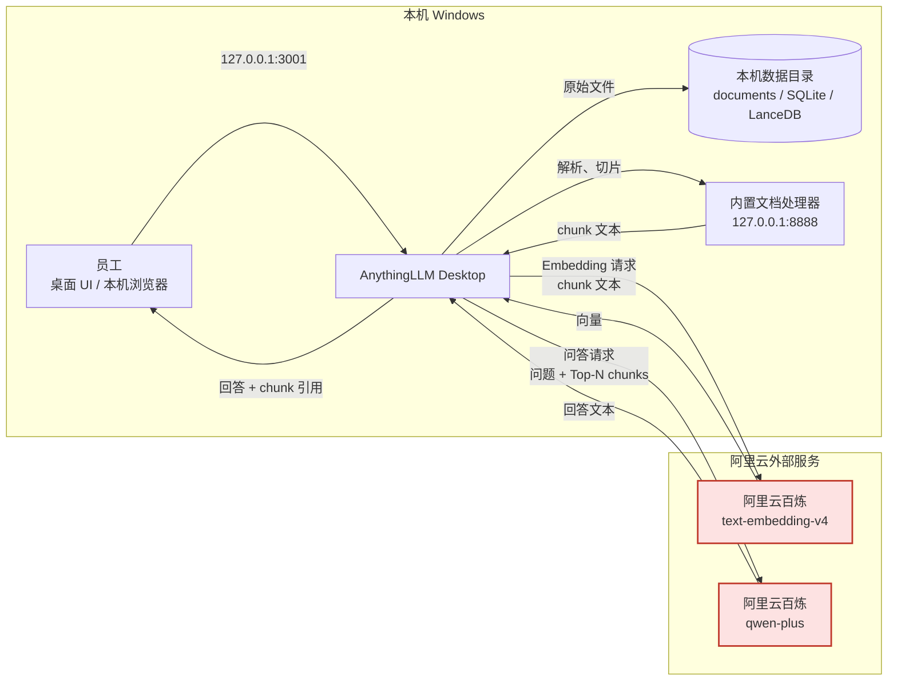

# 系统架构与数据流（AnythingLLM 桌面版）

> 版本：v0.2（2026-10-18）
> 底座：AnythingLLM Desktop v1.18.0（原生 Windows 应用）
> 模型：阿里云百炼 `qwen-plus` + `text-embedding-v4`（OpenAI 兼容接口）
> 适用范围：单台企业内部 Windows 电脑的本地演示验证版

## 0. 重要边界声明

> **文档切片和问答内容会发送至百炼（阿里云）外部服务。**
>
> - 文档在本机解析、切片后，**chunk 文本**会发送到阿里云百炼生成向量；
> - 用户提问与检索命中的 **chunk 文本**会发送到阿里云百炼的 `qwen-plus` 生成回答；
> - 原始 PDF/Word 文件保存在本机，但其中的文本内容会离开本机；
> - 因此本项目只允许使用 `data/` 下的**虚构资料**，禁止导入真实企业资料、客户信息、真实工艺参数或个人信息。

## 1. 组件与职责

| 组件 | 运行位置 | 职责 | 是否自建 |
| --- | --- | --- | --- |
| AnythingLLM Desktop | 本机 `D:\RAG库\AnythingLLM` | 桌面 UI、工作区、文档管理、检索编排、引用展示 | 否（官方安装包） |
| AnythingLLM 内置服务 | 本机 `127.0.0.1:3001` | Web/API 服务、SQLite 元数据、文档与向量检索 | 随桌面版 |
| 文档处理器（collector） | 本机 `127.0.0.1:8888` | PDF/Word 文本提取、切片 | 随桌面版 |
| SQLite | 本机数据目录 | 工作区、文档、会话、设置等元数据 | 随桌面版 |
| LanceDB | 本机数据目录 | chunk 向量与相似度检索 | 随桌面版 |
| 阿里云百炼 | 阿里云外部服务 | `text-embedding-v4` 向量化、`qwen-plus` 回答生成 | 否（在线 API） |

**不再使用的组件**：RAGFlow、Docker Desktop、WSL2、Elasticsearch、MySQL、MinIO、Valkey。原 RAGFlow 方案因目标机资源不足废弃，见 `README.md` 的 ADR-001。

## 2. 部署形态



图中红色节点为**外部服务**。本机与百炼之间只走 HTTPS 443，不开放入站端口。

## 3. 数据流

### 3.1 文档入库

1. 员工在 AnythingLLM 工作区上传 PDF/Word。
2. 原始文件保存到本机 `storage/documents`。
3. 内置文档处理器在本机提取文本、按配置切片。
4. 每个 chunk 的文本发送到百炼 `text-embedding-v4`，返回向量。
5. 向量写入本机 LanceDB；文档、chunk 元数据写入 SQLite。
6. 原始文件与向量索引均留在本机，但 chunk 文本已发送到阿里云。

### 3.2 问答与引用

1. 员工提问，问题文本发送到百炼 `text-embedding-v4` 生成查询向量。
2. AnythingLLM 在本机 LanceDB 中检索 Top-N 相似 chunk。
3. 问题与命中的 chunk 文本一起发送到百炼 `qwen-plus`。
4. `qwen-plus` 返回回答；AnythingLLM 将回答与 chunk 元数据关联。
5. UI 展示回答及引用来源（文档名、片段、相似度等）。
6. 验收时以“引用片段是否真的支持回答”为准，不以文件名称为唯一依据。

### 3.3 评测通道

`tests/eval.py` → `POST http://127.0.0.1:3001/api/v1/workspace/{slug}/chat` → AnythingLLM → 百炼。
脚本记录 `textResponse` 与 `sources[]`，按题目的判定规则输出命中/未命中/拒答/编造。

## 4. 本机数据存储

实测数据目录：

```text
C:\Users\Administrator\AppData\Roaming\anythingllm-desktop\
├── storage\
│   ├── anythingllm.db        # SQLite：工作区、文档、会话、设置
│   ├── documents\            # 上传的原始文件与解析结果
│   ├── lancedb\              # 向量索引
│   ├── hotdir\               # 热目录
│   ├── vector-cache\         # 向量缓存
│   ├── logs\                 # 运行日志
│   ├── models\               # 本地模型（本项目不使用）
│   └── .env                  # 本机模型 provider 配置（含 key，禁止提交）
├── Cache\
├── Local Storage\
└── Preferences
```

- **安装目录**：`D:\RAG库\AnythingLLM`
- **数据目录**：`%APPDATA%\anythingllm-desktop`（本机为 `C:\Users\Administrator\AppData\Roaming\anythingllm-desktop`）
- 卸载应用不会自动删除数据目录；重装后仍可恢复工作区。
- 数据目录位于用户目录，受 Windows 账户权限保护，但未做企业级磁盘加密；演示机应启用 BitLocker 或等价保护。

## 5. 端口与网络

| 端口 | 绑定 | 用途 | 是否对外 |
| --- | --- | --- | --- |
| 3001 | `127.0.0.1` | AnythingLLM Web/API | 否，仅本机 |
| 8888 | `127.0.0.1` | 文档处理器 collector | 否，仅本机 |
| 9222 | `127.0.0.1` | 仅调试时启用的 Electron CDP | 否，验收后关闭 |

出站：`https://dashscope.aliyuncs.com`（443）。
入站：不开放；不使用公网域名、端口映射或反向代理。

## 6. 信任边界与限制

1. **文本出本机**：chunk 与问题会到阿里云百炼；这是本方案的核心数据流，不是可选项。
2. **单机单用户**：AnythingLLM Desktop 面向本机使用，不提供企业 SSO、多租户、细粒度权限。
3. **本机数据保护**：依赖 Windows 登录账户、磁盘加密与物理安全；应用本身不是企业级密钥管理系统。
4. **模型依赖公网**：百炼不可用、欠费或限流时，问答/入库会失败；第一版不做离线降级。
5. **引用可核验**：引用是 chunk 级，但仍需人工核对片段是否支持结论；评测脚本只做规则初筛。

## 7. 相关文档

- 安装与配置：[deployment.md](deployment.md)
- 安全基线：[security.md](security.md)
- 选型决策：[README.md](../README.md) 的 ADR-001
- 已知问题：[known-issues.md](../known-issues.md)
